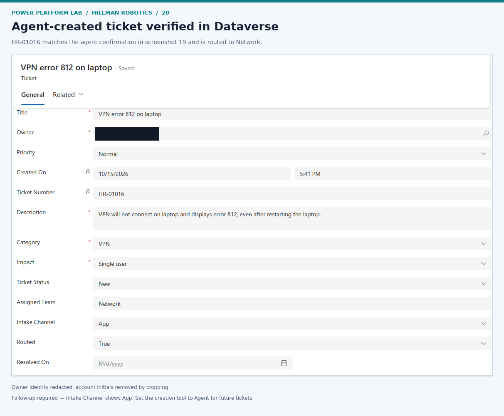
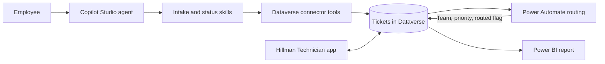

# Hillman Robotics Power Platform Lab

**A working Power Platform help desk, from an employee's request to a routed ticket and a Power BI report.**

Built for a fictional robotics company using Microsoft Dataverse, Power Apps, Power Automate, and Copilot Studio. The agent collects an issue, asks for confirmation, creates a ticket through a Dataverse connector, and retrieves its saved status. A separate cloud flow handles routing and priority.

**Core lab complete · October 2026 · Synthetic data · Development environment**

## Explore the build

**[Open the screenshot slideshow →](https://cfollette18.github.io/power-platform-lab/)**

[Browse all 21 screenshots](docs/evidence.md) · [Architecture and decisions](docs/architecture.md) · [Lab results](docs/results.md)

## What I built

| Component | Implementation | Evidence |
|---|---|---|
| Data foundation | Ticket table, required fields, choices, autonumber, synthetic records | [Schema](docs/screenshots/03-ticket-schema.png), [sample records](docs/screenshots/04-sample-tickets.png) |
| Technician workspace | Model-driven Power App for viewing and updating tickets | [Queue](docs/screenshots/05-technician-app.png), [saved update](docs/screenshots/06-ticket-detail.png) |
| Routing automation | Dataverse Added trigger; category selects team; impact selects priority | [Logic](docs/screenshots/10-category-routing.png), [successful run](docs/screenshots/15-vpn-routing-success.png) |
| AI intake | Dedicated intake skill, confirmation, connected create-row action | [Tool](docs/screenshots/18-create-ticket-tool.png), [confirmed submission](docs/screenshots/19-agent-ticket-confirmation.png) |
| Live status lookup | Dedicated status skill and Dataverse List rows action | [Lookup tool](docs/screenshots/21-ticket-lookup-tool.png), [returned status](docs/screenshots/22-agent-ticket-status-verified.png) |
| Reporting | Power BI browser report and saved Tickets by Status chart, built on Linux | [Initial report](docs/screenshots/23-power-bi-initial-report.png) |

## How it works

The AI handles conversation and tool selection. Dataverse stores the record. Power Automate applies explicit routing rules. Assigned Team is a text routing label, not proof that a technician owns the ticket or received a notification.

## Demonstrated outcome

1. An employee reported VPN error 812 affecting one user.
2. The agent summarized the request and waited for confirmation.
3. Its Dataverse action created **HR-01016**.
4. The technician app confirmed the same number, description, and category, with **Network / Normal / Routed = True**.
5. A subsequent agent lookup returned the saved ticket's status and routing values.
6. A Power BI snapshot showed **12 tickets: 5 New, 5 In Progress, 2 Resolved**. These are lab snapshot counts, not production metrics.

## Repository contents

- `docs/index.html` — keyboard-accessible slideshow with all saved screenshots, captions, and full-resolution links; also works locally.
- `docs/evidence.md` — complete screenshot gallery with numbered checkpoints.
- `docs/architecture.md` — component boundaries and configuration decisions.
- `docs/results.md` — verified results, reported follow-ups, and deferred work.
- `docs/ticket-schema-review.md` — retained schema and numeric choice mappings.
- `agent/` — local instruction and skill artifacts; see [artifact notes](agent/README.md) before reuse.
- `knowledge/hillman-support.txt` — prepared fictional support knowledge; upload and grounding were not verified.

Screenshots retain their original numbers, including gaps. Account identities and environment identifiers were cropped or redacted before publication. Private exports, authentication files, raw responses, and unredacted originals are excluded.
